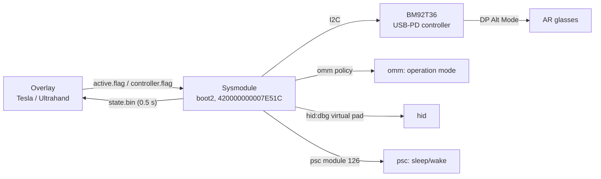

# How Switchlens works

Everything below is what the code does and what was measured on one console (firmware 23.0.1,
Atmosphere 1.12.1). Statements about other setups are marked **[inference]**.

## Components



The overlay never talks to hardware. It writes flag files and reads `state.bin`; the sysmodule owns all
hardware and OS interaction. Both live on the SD card under `switch/ar_glasses/`.

## 1. Getting DisplayPort out of the USB-C port

The console's USB-C port is managed by a ROHM **BM92T36** USB-PD controller, reached through the system I2C
service as `I2cDevice_Bm92t30mwv`. By default the console only negotiates DP when docked in the official dock.
Switchlens drives the chip itself.

Registers and commands used (16-bit values little-endian; command register written as `05 lo hi`):

| Item | Value | Use |
|---|---|---|
| `REG_STATUS1` `0x03` | bit 7 | cable inserted |
| `REG_DP_STATUS` `0x18` | `0x8000` DP enabled, `0x0080` HPD | link-up test is both bits (`0x8080`); healthy reads `0x808A` |
| `REG_INCOMING_VDM` `0x50` | 6 bytes | the glasses' DP capabilities; byte 2 bit 2 selects pin assignment C, otherwise D |
| `REG_OUTGOING_VDM` `0x60` | `04 06 <pin> 00 00` | DP configure message |
| command `0x3131` | | DP enter mode |
| command `0x3636` | | DP configure and start HPD |
| command `0x3434` | | start HPD |
| command `0x3B3B` | | stop HPD, exit DP mode |

Engage sequence (`chipEnterDp`): `0x3131` -> read incoming VDM -> write outgoing configure VDM ->
`0x3636` -> `0x3434` -> poll `DP_STATUS` until `0x8080`. Up to 3 attempts (attempts 2+ send `0x3B3B` first). If HPD
never rises the console display is left untouched.

Quirk: exiting DP mode and re-entering leaves HPD low (`DP_STATUS 0x800A`, black glasses) until the cable is
renegotiated. So a user toggle-off only gives the screen back to the console (soft disengage) and leaves the chip
in DP mode; the chip is exited (`0x3B3B`) only on unplug, link loss, sleep and shutdown.

## 2. Making the console render to it

With HPD up, the sysmodule calls `omm` command 10 (`SetOperationModePolicy`) with policy `2` (force docked).
The console then switches to docked output and the glasses show it. Disengage restores policy `0` (auto).
It also sets the persistent TV `underscan` setting to 0 once (logged `underscan N -> 0`) so the picture
is not shrunk. This setting is not restored on removal.

## 3. State machine

Main loop ticks every 100 ms. Debounce and timing constants (see `main.cpp`):

| Constant | Value | Meaning |
|---|---|---|
| `BOOT_DELAY_MS` | 15 s | let Home come up before the first engage |
| `CABLE_ON_TICKS` / `CABLE_OFF_TICKS` | 300 ms / 1.2 s | plug and unplug debounce (single-read glitches observed) |
| `CHIP_STABLE_TICKS` | 1 s | STATUS1 must be steady before engaging |
| `LINK_LOST_TICKS` | 1.5 s | no DP_EN while engaged -> full teardown, re-engage |
| `MAX_AUTO_REENGAGE` | 3 | then wait for a replug or a switch toggle |

`state.bin` states: 0 idle, 1 negotiating, 2 active, 3 sleeping.

## 4. Sleep and wake

The module registers as a psc power-management module (id 126, no dependencies). Earlier versions that did
**any** work during the sleep transition (omm, vi, i2c or hid calls from the psc handler) soft-locked the console
on wake. The final design:

- The psc handler only records the state in memory and acknowledges. It makes no service call.
- The virtual-controller thread goes quiet (no hid calls) from the first sleep-window state until Awake.
- After Awake, a `quietUntil` delay and a `wakeCleanup` pass tear everything down (omm back to auto,
  exit DP), then the normal state machine re-engages.
- `no_psc.flag` skips psc registration entirely, for isolating problems.

Related boot-time rule: the heap is a fixed 256 KB (`__libnx_initheap` override). libnx's default claims most of
the free system pool and starves `am` at boot (fatal 2001-0132 was observed with the default).

## 5. Joy-Cons while AR is on

When the console is forced docked, games stop seeing the rail-attached Joy-Cons. What was tried:

| Approach | Result |
|---|---|
| Remap the Handheld npad to Player 1 (`hidSwapNpadAssignment` + Dual modes) | worked in menus and most games; **failed in Mario Kart 8 Deluxe**; also had a toggle-parity bug when re-applied |
| Hook/intercept at API level | reported to fail on MK8D by other projects **[inference from ReverseNX-RT issue #23]** |
| **Virtual Pro Controller via `hid:dbg` HDLS** | works everywhere tested, including MK8D |

Why the last one works: probing showed the rail Joy-Con **buttons and sticks remain readable** through
`hiddbgDumpHdlsStates` (entries with `npadInterfaceType == Rail`) even docked with AR on, and a virtual
`FullKey3` Bluetooth device attaches on Player 1. A worker thread (`vpadThreadFn`, core 3, priority 44) loops at
about 125 Hz: dump rail entries, OR the buttons (SL/SR stripped), take the left stick from the left Joy-Con and the right stick from the
right one, and `hiddbgSetHdlsState` the result. Games just see a wireless Pro Controller.
The overlay learns whether the pad is attached from bit 0 of `ArGlassesStatus.reserved`.

Not forwarded: HD rumble, NFC, IR camera, gyro (see below).

## Gyro (experimental)

Probe results (`probes/gyro_probe.cpp`, AR on, docked, Joy-Cons attached):

- HDLS dump entries for the rail Joy-Cons carry **no** motion data (always zero).
- The Handheld npad has style 0 (inactive) while docked, so hid six-axis reads give nothing...
- ...until `hidsysEnableHandheldHids()` is called: the Handheld npad then reports as JoyDual and
  `hidGetSixAxisSensorStates` returns real motion (acceleration range ~20 g while shaken vs ~0.1 g still).

`controller.flag` = `2` or `3` makes the sysmodule enable handheld hids, read the right Joy-Con's six-axis state and
put it into the virtual pad's `six_axis_sensor_acceleration` and `six_axis_sensor_angle` fields
(`2`: angular velocity into the angle field, `3`: integrated angle). The semantics of that HDLS field are not
documented anywhere I could find (libnx and the Switchbrew wiki list the field but not its meaning). Whether games
honour it, and which of `2`/`3` is right, is **not yet confirmed** at the time of writing. The sysmodule restores the
previous handheld-hids state when passthrough stops. Treat as experimental.

## 6. Overlay <-> sysmodule protocol

`state.bin` is rewritten every 0.5 s (little-endian, packed):

```
u32 magic = 0x53475241 ("ARGS")
u32 version = 1
u32 state            0 idle, 1 negotiating, 2 active, 3 sleeping
u16 status1          BM92T36 STATUS1 (bit 7 = cable)
u16 dp_status        BM92T36 DP_STATUS
u16 alert_status
u16 reserved         bit 0: virtual Pro Controller attached
u64 heartbeat        increments while the sysmodule is alive
```

The overlay treats the service as dead if the heartbeat has not changed for about 5 s. Flags are single ASCII
characters, polled every 0.5 s, so changes apply live.

## 7. Permissions (NPDM)

`sm:`, `set:sys` (firmware version, TV settings), `i2c` (PD chip), `fsp-srv` (SD card), `omm` (operation mode),
`psc:m` (sleep/wake), `hid:dbg` (virtual pad), `hid` and `hid:sys` (gyro experiment only). `filesystem_access` is
currently all-permissions; it only needs the SD card and could be narrowed (unverified).

## 8. Probes

`probes/hid_probe.cpp` (controller paths) and `probes/gyro_probe.cpp` (motion) are standalone homebrew NROs, built
the same way as the overlay without the NACP. They write results to `switch/ar_glasses/` and were used to produce
the findings above.

## Known unverified areas

Other firmware versions, other Switch models and revisions, other glasses, 30-minute soak, shutdown while
engaged, and the non-fatal `omm policy 0 rc=0x258b1` seen once at wake cleanup.
